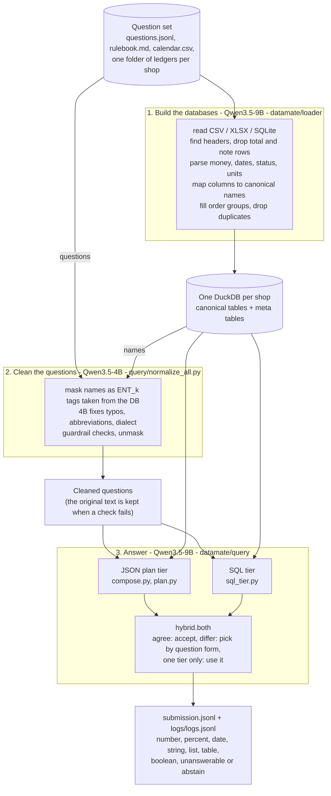

# DataMate — team Fall to Fly, Zalo AI Challenge 2026

A system that answers Vietnamese questions about the ledgers of small shops: it reads ledgers in many file formats (CSV, XLSX, SQLite) with very
different layouts, builds a DuckDB database for each shop, and answers questions such as "revenue of last year's fourth quarter", "which product sold best last week",
"which customer owes the most" (illustrative examples). This is the team's source code for the **DataMate** task, cleaned up for publication.

> **Not included:** the contest data (train, public and private test sets), the training data (`*.jsonl`), the few-shot example store `docker/assets/`, the model weights and
> LoRA adapters, and the generator's input calendar file. They belong to the contest organiser (BTC) or are too large for git; see [docker/README.md](docker/README.md) and [finetune/README.md](finetune/README.md).

## The task
Each shop has a folder of ledgers (orders, order lines, stock, debt...) plus a self-describing `README.md`. Each question looks like:
```json
{"id": "...", "business_id": "...", "question": "...", "as_of_date": "YYYY-MM-DD"}
```
`as_of_date` is the question's "today". The question set also has a `rulebook.md` (the general rules for computing answers) and a `calendar.csv` (solar–lunar calendar, holidays).
An answer is one JSON line per question, `{"id", "type", "answer"}`, of type `number`, `percent`, `date`, `string`, `list`, `table`, `boolean`, or `unanswerable` (the ledger lacks the information)
or `abstain` (no answer given). A correct answer scores +1, a wrong one −1, `abstain` or a missing line 0. Examples (invented):

| Type | Example line | Notes |
|---|---|---|
| `number` | `{"id": "q_0001", "type": "number", "answer": 125000000}` | Money is a whole number of dong; other numbers are rounded to 2 decimals |
| `percent` | `{"id": "q_0002", "type": "percent", "answer": 12.5}` | The percentage as a number, 2 decimals |
| `date` | `{"id": "q_0003", "type": "date", "answer": "2026-03-14"}` | `YYYY-MM-DD`; a question about a month gets `"2026-03"` |
| `boolean` | `{"id": "q_0004", "type": "boolean", "answer": true}` | |
| `string` | `{"id": "q_0005", "type": "string", "answer": "Bánh mì thịt"}` | A name as written in the shop's data (a code is also accepted) |
| `list` | `{"id": "q_0006", "type": "list", "answer": [1200000, 980000, 1500000]}` | In the order the question states, e.g. month by month |
| `table` | `{"id": "q_0007", "type": "table", "answer": {"columns": ["doi_tuong", "gia_tri"], "rows": [["Nguyễn Văn An", 3200000], ["Trần Thị Bình", 2750000]]}}` | Only when the question asks for a table or for several objects with a measure each; the first column is the object's name |
| `unanswerable` | `{"id": "q_0008", "type": "unanswerable"}` | The shop does not record that kind of information, or the period is outside the data |
| `abstain` | `{"id": "q_0009", "type": "abstain"}` | No answer; also written for a question the run did not finish |

**`§N` in comments and docs** means section N of the contest's `rulebook.md`. The numbering below is that of the team's copy,
[finetune/bo_sinh/thu_vien_goc/rulebook.md](finetune/bo_sinh/thu_vien_goc/rulebook.md) (written in Vietnamese):

| § | Topic |
|---|---|
| §1 | Orders and revenue (which orders count, returns and cancellations) |
| §2 | Time (week, quarter, "last N days", Tet period, as-of date) |
| §3 | Ranking, and what counts as the same item or customer ("best seller" by quantity in base units) |
| §4 | Debt |
| §5 | Stock, purchases, cost, profit |
| §6 | Rules per industry |
| §7 | When the answer is `unanswerable` |
| §8 | How data is written in the files (blank cells filled down, duplicate rows, total rows, date and money formats) |
| §9 | Answer format and scoring |
| §10 | Units and conversion |

## Pipeline


The three stages run one after the other on the same GPUs: `docker/run.sh` starts the 9B server, builds the databases, stops it, starts the 4B server to clean the questions,
stops that, and restarts the 9B server to answer.

## How it works
1. **Build the database** (`datamate/loader/`): find the header row, drop total and note rows, merge sheets of the same ledger, normalise money, dates, order status and
   units; map columns to a canonical schema ([datamate/schema.md](datamate/schema.md)) using rules, the shop's `README.md` descriptions, and an LLM. The result is
   one DuckDB file per shop.
2. **Clean the question** (`datamate/query/normalize_all.py`): a small model fixes abbreviations, missing accents and dialect words, and replaces product and customer names with `<ENT_k>` tags
   taken from the database itself. It checks that numbers, years, months and tags are preserved; a question that fails the check keeps its original text.
3. **Answer** (`datamate/query/`): two independent tiers, combined in `hybrid.py`:
   - **JSON plan** (`compose.py`, `plan.py`): the LLM picks the canonical table, the operation and the period; Python code computes the answer;
   - **SQL** (`sql_tier.py`): the LLM writes one DuckDB SQL query over the canonical views.

   How they are combined (`hybrid.both`): if the two tiers agree the answer is accepted; if they differ, the JSON plan is used for familiar question forms and SQL for unfamiliar ones (for a shop whose `README.md`
   describes no columns the answer is left blank); if only one tier answers, that answer is used. If both conclude that the ledger does not record the requested kind of information the answer is `unanswerable`.

The full procedure (start vLLM, build the DBs, clean, answer, write the files) is in [docker/run.sh](docker/run.sh).

## Models
| Model | Revision | Role | License |
|---|---|---|---|
| `Qwen/Qwen3.5-9B` + merged LoRA | `c202236235762e1c871ad0ccb60c8ee5ba337b9a` | Column mapping when building the DB, JSON plans, writing SQL | Apache-2.0 |
| `Qwen/Qwen3.5-4B` + merged LoRA | `851bf6e806efd8d0a36b00ddf55e13ccb7b8cd0a` | Question cleaning | Apache-2.0 |

Both were released on 2026-02-27, 14.313 billion parameters in total, run one after the other (not at the same time). The pipeline calls them through a vLLM server (`DATAMATE_LLM_URL`).

## Third-party material
- **Models:** Qwen3.5-9B and Qwen3.5-4B, from the table above, Apache-2.0. The weights are not in the repo.
- **Vietnamese syllable list:** `datamate/query/am_tiet_viet.txt` (8,915 syllables) is drawn from the Viet74K word list compiled by Ho Ngoc Duc
  ([github.com/duyet/vietnamese-wordlist](https://github.com/duyet/vietnamese-wordlist), which states the GNU GPL v2 as its license). `datamate/query/telex.py` uses it to accept a Telex typo repair
  only when the result is a real syllable.

## Repo structure
| Folder / file | Contents |
|---|---|
| [datamate/](datamate/) | The main code: `loader/` (DB building), `query/` (cleaning and answering), `run_all.py` (build DBs for a whole set), `submit.py` (the SQL-template path, no LLM needed) |
| [docker/](docker/) | `run.sh` (the run procedure), `Dockerfile`, build and run instructions |
| [finetune/](finetune/) | The synthetic-data generator and the fine-tuning code for the two models (QLoRA, LoRA merging), configurations and logs |
| [tests/](tests/) | 492 tests, no GPU or model needed |
| `requirements.txt`, `requirements-dev.txt` | Libraries to run the pipeline; add `pytest` to run the tests |

`datamate/tests/verify_answers.py` is real run-time code (imported by `compose.py` and `submit.py`), not a test.

Most identifiers, file and folder names, the prompts sent to the LLM, run-time log messages of the Python code, and the sample data in the tests are in Vietnamese, because the task is
Vietnamese; comments, docstrings and documentation are in English. See the glossary below.

## Quick start
**Run the tests** (Python 3.11):
```bash
pip install -r requirements-dev.txt
pytest tests              # add -n 4 to run in parallel
```

**Build the DBs and answer without a GPU** (needs a question set with `questions.jsonl`, `rulebook.md`, `calendar.csv` and a `data/<shop id>/` folder):
```bash
pip install -r requirements.txt
python -m datamate.run_all <question-set folder>/data --out <DB folder> --skip-tables
python -m datamate.submit <question-set folder> <DB folder>/<question-set folder name> --out submission.jsonl
```
This path uses only the pre-written SQL templates and does not call an LLM: a question of a familiar form gets an answer, the rest are written as `abstain` (or `unanswerable` when the ledger clearly lacks the source).

**Full run** (two models, vLLM, GPU): see [docker/README.md](docker/README.md). You must prepare the models and the few-shot example store yourself.

## Glossary of Vietnamese terms in the code
| Term | Meaning |
|---|---|
| `don`, `dong_ban`, `ton`, `no` | order, sales line, stock, debt (the canonical views `v_don`, `v_dong_ban`, `v_ton`, `v_no`) |
| `nguon`, `phep`, `cot`, `ky`, `loc`, `nhom` | source (table), operation, column, period, filter, group (keys of a JSON plan) |
| `tong`, `dem`, `tb` | sum, count, average |
| `hoan_thanh`, `huy`, `tra_hang`, `dang_giao` | order status: completed, cancelled, returned, in delivery |
| `tra_loi`, `khong_ghi`, `thieu_nguon`, `ngoai_ky`, `khong_chac` | tier outcome: answered, the ledger does not record it, missing source, period outside the data, not sure |
| `luat`, `luat_goc`, `luat_doi` | rule, the rules hard-coded in the code, rules changed by a contest set |
| `tu_sua` | the data layer's self-repair loop |
| `bo_sinh`, `thu_vien_goc`, `nganh` | generator, its base library, industry |
| `kehoach`, `ke_hoach` | plan |
